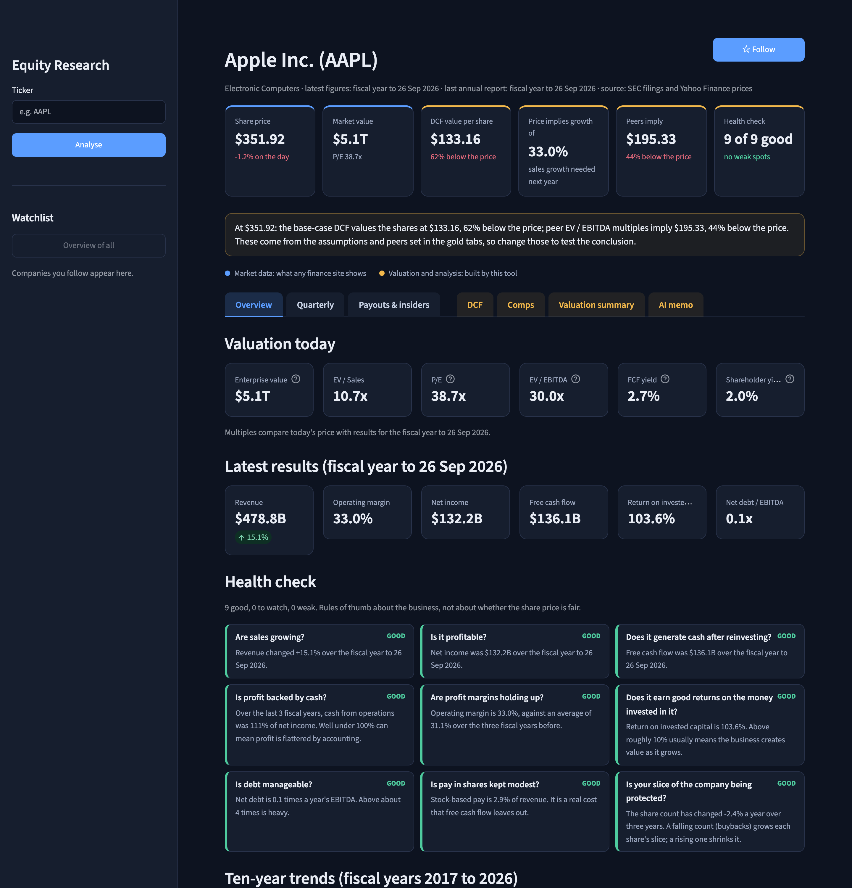
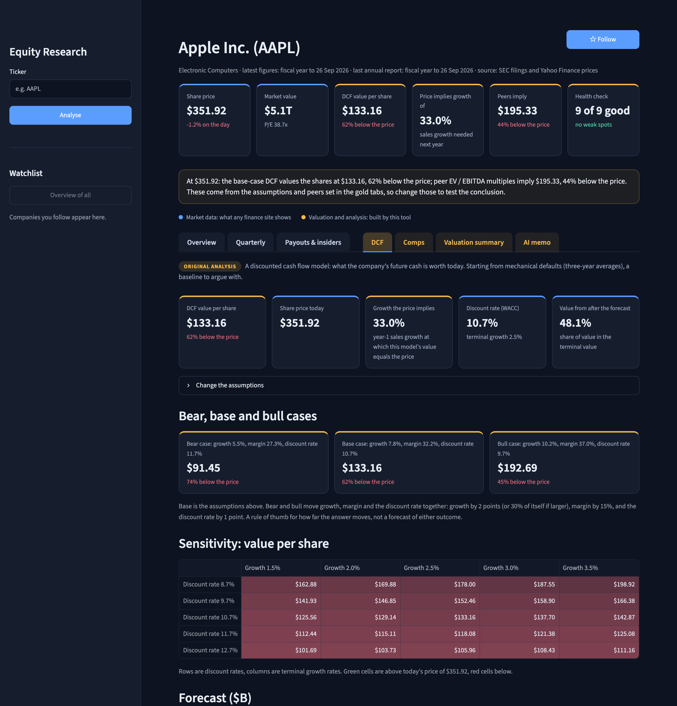
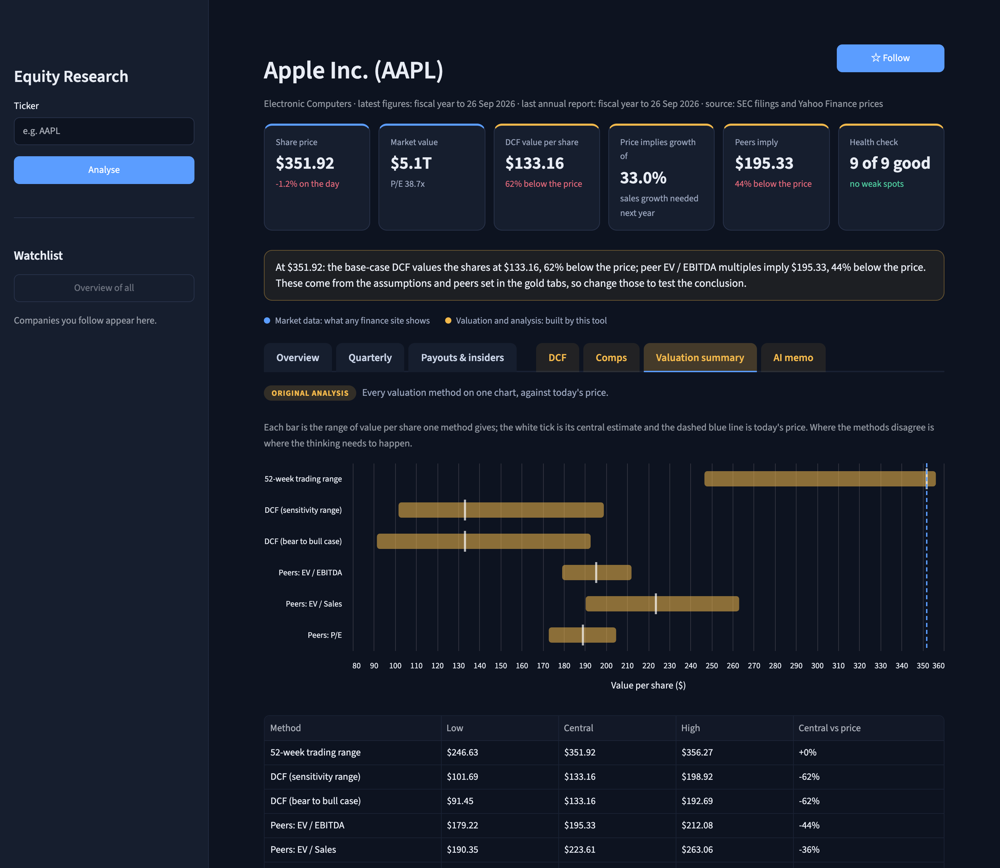
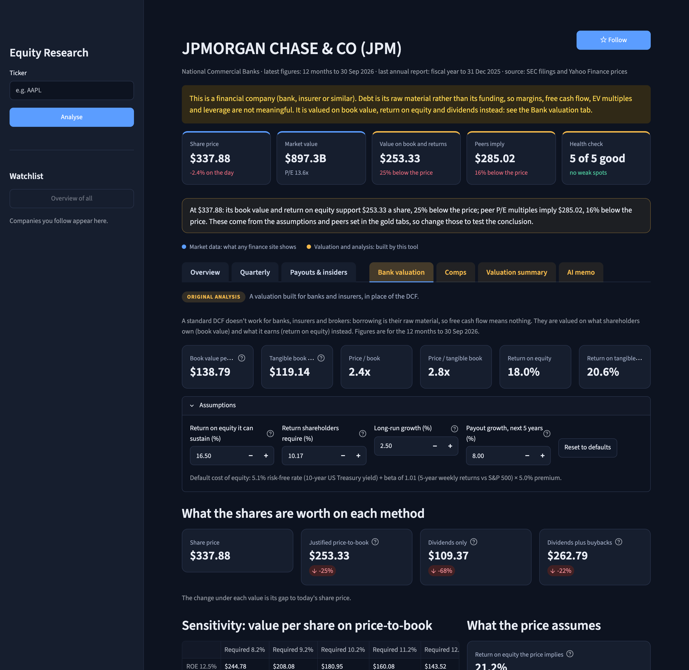

# Equity Research Tool

A valuation workbench for US-listed companies. Type a ticker and it pulls the
company's own SEC filings and its share price, then builds the analysis an equity
analyst would start from: a discounted cash flow model, a peer comparison, a
bank-specific valuation where a DCF doesn't apply, and a plain-English health check.

**[Try the live demo](https://equity-workbench.streamlit.app/?ticker=AAPL)** (it may take a moment to wake up if nobody has used it recently).

## What it does

- **Live data, no paid feeds.** Financial statements come straight from SEC EDGAR
  (the XBRL figures companies file), prices from Yahoo Finance. Results are rebuilt
  for the latest twelve months from quarterly reports, so the numbers are not a
  year old.
- **A DCF you can argue with.** Every assumption is editable, with a WACC build-up,
  bear, base and bull cases, a sensitivity table, and a reverse DCF that shows the
  growth today's price already assumes.
- **The right model for the company.** Banks, insurers and brokers get a
  price-to-book and dividend discount valuation in place of the DCF.
- **Every method on one chart.** A "football field" sets the DCF, peer multiples
  and the trading range against today's price.
- **Checked by hand.** The calculations are covered by tests that compare them with
  numbers worked out by hand on small made-up companies.

| | |
| --- | --- |
|  |  |
| **DCF** with scenarios and sensitivity | **Valuation summary** across every method |

## The tabs

- **Overview**: today's valuation, results for the latest twelve months, a health
  check (rule-of-thumb questions answered from the numbers), how the share price has
  behaved against the S&P 500, and ten years of financial statements.
- **Quarterly**: the last eight quarters, growth against a year earlier, and the
  latest twelve months against the last annual report.
- **DCF**: a discounted cash flow model with editable assumptions, a WACC build-up,
  a sensitivity table, bear/base/bull cases and a reverse DCF (the growth today's
  price implies).
- **Bank valuation** (shown instead of the DCF for banks, insurers and brokers): book
  value, return on equity, a justified price-to-book value and a dividend discount model.
- **Comps**: peer multiples and the share value they imply, with editable peers.
- **Valuation summary**: every method on one "football field" chart against the price.
- **Payouts & insiders**: dividends, buybacks, the share count, pay in shares, and
  what directors and executives have been buying and selling.
- **AI memo**: Claude reads the numbers and the annual report and writes a one-page
  briefing. It explains and questions; it does not make a buy or sell call. It runs
  on your Claude subscription, with no per-use charge.
- **Watchlist**: follow companies and get a snapshot of each one every weekday.

Every company page opens with an at-a-glance strip: price, market value, the DCF
value, what peers imply, the growth the price implies and the health-check score,
with one sentence putting them together.

The tabs are in two colour-coded groups. Blue tabs (Overview, Quarterly, Payouts &
insiders) are market data of the kind any finance site shows. Gold tabs (DCF or
Bank valuation, Comps, Valuation summary, AI memo) are this tool's own analysis.
The colours and the rest of the look are set in `.streamlit/config.toml` and
`views/style.py`.

Built with AI assistance (Claude Code).

## Run it

Double-click the launcher for your system:

- **Mac:** `Start Equity Research.command`
- **Windows:** `Start Equity Research.bat`

The first run sets up a private Python environment in this folder and installs the
libraries, which takes a few minutes. After that it starts the app and opens it in
your browser. Keep the launcher's window open while you use the app.

For a Desktop icon, make a shortcut (Windows) or alias (Mac) to the launcher and
move that to the Desktop. The launcher itself has to stay in this folder.

To run it by hand instead: `pip install -r requirements.txt`, then
`streamlit run app.py`.

### Optional settings

Environment variables you set before starting the app.

| Variable | What it unlocks |
| --- | --- |
| `SEC_USER_AGENT` | Set to your name and contact email, or put the same text in a file called `sec_contact.txt` in this folder. The SEC only serves its full ticker list and the text of annual reports to tools that identify themselves. Without it, about 125 built-in tickers work and the AI memo runs without the annual report. |
| `ANTHROPIC_API_KEY` | Not needed. Only if you set it does the app offer a third, pay-per-call way to write the memo. |

### Writing the AI memo without paying per use

The memo tab offers two routes that use a Claude subscription:

1. **Claude Code** (one click): install the Claude Code command-line tool, then sign
   in once by running `claude auth login` in a terminal. The app then asks it to
   write the memo, which counts against your subscription's usage limits.
2. **claude.ai** (by hand): download the prepared prompt file, attach it to a chat
   at claude.ai, and paste the memo back into the app.

## Hosting a public copy

The app runs as it is on [Streamlit Community Cloud](https://streamlit.io/cloud):
point it at this repository and `app.py`, and add `SEC_USER_AGENT` (your name and
contact email) under the app's Secrets.

A hosted copy switches itself into public-demo mode (`PUBLIC_DEMO` in
`research/config.py`). Each visitor's watchlist, assumptions and memos are kept in
their own browser session and never written to disk, so strangers don't see each
other's work, and the memo routes that would spend the owner's Claude usage are off.

## The daily refresh

`python -m research.refresh` re-runs every company on your watchlist and adds one
row per company to `userdata/snapshots.csv`.

`.github/workflows/daily-refresh.yml` runs that command on GitHub every weekday at
22:30 UTC (after the US market closes) and commits the new snapshot. To turn it on:
push this project to GitHub, and add `SEC_USER_AGENT` under
Settings > Secrets and variables > Actions. Pull the repository to see the new data
in the app.

Prices change daily but financial statements change only when a new report is
filed, so most days the refresh moves the price, the multiples and the gap between
the DCF value and the price. It also records each company's latest filing, and the
watchlist marks filings from the last week as new.

## How it works

| File | Job |
| --- | --- |
| `research/edgar.py` | Turns a ticker into the SEC's company ID; downloads filing data and the list of recent filings |
| `research/statements.py` | Picks the annual figures out of the raw filing data into one table |
| `research/quarterly.py` | Single quarters and the trailing twelve months, from quarterly reports |
| `research/metrics.py` | Margins, growth, returns, leverage and valuation multiples |
| `research/checks.py` | The health check |
| `research/pricestats.py` | Returns, 52-week range, moving averages, volatility |
| `research/prices.py` | Five years of daily share prices |
| `research/market.py` | Risk-free rate and beta, for the discount rate |
| `research/dcf.py` | The DCF: forecast, WACC, terminal value, sensitivity, scenarios, reverse DCF |
| `research/financials.py` | Valuation for banks, insurers and brokers |
| `research/payouts.py` | Dividends, buybacks, share count and stock-based pay |
| `research/insiders.py` | Insider trades from SEC Form 4 filings |
| `research/comps.py` | Peer suggestions, peer multiples and implied values |
| `research/filings.py` | Downloads the annual report and extracts the key sections |
| `research/memo.py` | Builds the prompt and calls Claude for the memo |
| `research/store.py` | Saves your watchlist, assumptions, peers, snapshots and memos in `userdata/` |
| `research/refresh.py` | The daily refresh |
| `research/report.py` | Ties the pieces together for one ticker |
| `app.py`, `views/` | The screens |
| `tests/` | Checks the calculations against numbers worked out by hand |

Run the tests with `python -m pytest`.

## Assumptions baked in

These are judgement calls, set in `research/config.py`:

- Equity risk premium of 5%.
- Terminal growth of 2.5%.
- A 10-year forecast with growth fading in a straight line to the terminal rate.
- Default DCF inputs are three-year averages of the company's own history. They are
  a baseline to challenge, not a forecast. For most large, highly valued companies
  they produce a DCF value well below the share price; the reverse DCF shows what
  growth the price needs instead.

## Known limitations

- **US filers only.** Companies that don't file annual 10-K reports (most foreign
  and Canada-only listings) are not supported.
- **Banks and insurers** get a simpler valuation (price-to-book and dividends) in
  place of the DCF. It ignores things specialists look at, such as capital ratios
  and loan losses.
- **Trailing twelve months are pieced together** from quarterly reports by
  subtraction. If a company's quarters can't be matched up, the latest fiscal year
  is used instead and the page says so.
- **No analyst estimates or earnings dates.** There is no free, reliable source for
  them, so everything here is reported history plus your own assumptions.
- **Insider trades cover the latest 40 filings**, which for a large company is a few
  months. Routine awards and tax withholding are listed separately from open-market
  trades.
- **Bear and bull cases use fixed rule-of-thumb shifts**, not a view on the company.
- **Total debt is approximate.** Companies label debt inconsistently, and lease
  obligations are mostly excluded.
- **Operating income and D&A are rebuilt** from other lines when a company doesn't
  report them directly, so EBITDA can be approximate.
- **Market cap uses the average diluted share count from the latest quarter or
  year reported**, so it drifts slightly after buybacks and is wrong after a stock
  split until the next report. Older share counts are rescaled for splits by rule
  of thumb (a count that doubles or more in a year is treated as a split).
- **Stock-based compensation is not deducted** from free cash flow, which flatters
  companies that pay staff heavily in shares.
- **Peer suggestions are a hand-picked list** covering the built-in tickers. For any
  other company you choose the peers yourself.
- **Prices come from an unofficial Yahoo Finance feed** that can stop working.
- **Figures are not cross-checked** against a second data source.
